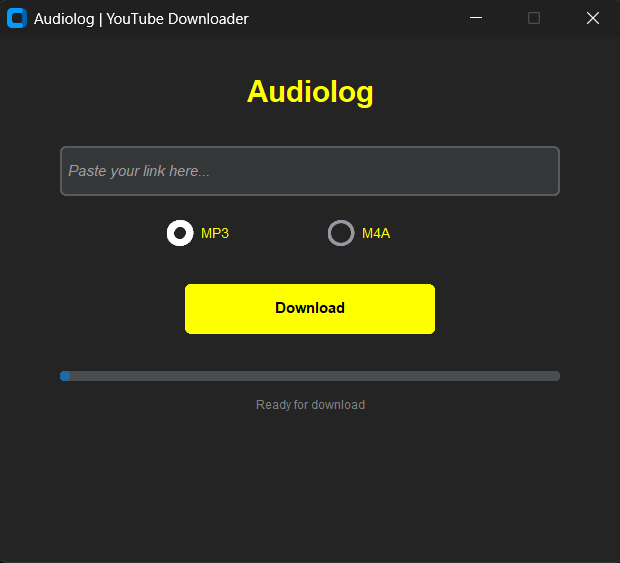
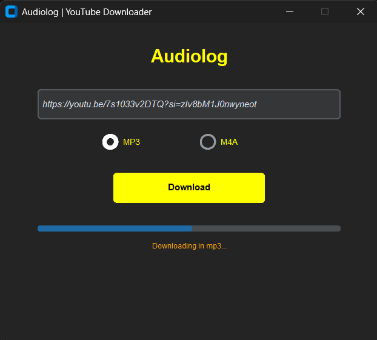
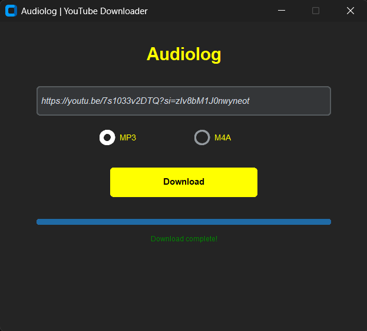

# Audiolog

Audiolog is a desktop application for downloading audio from YouTube videos in M4A and MP3 formats. The interface is built with CustomTkinter; audio extraction and conversion are handled in separate modules.

## Requirements

- Windows (preferably)
- Python3 (obvious)
- FFmpeg installed on the `PATH` to download in MP3 format
- Internet access

- `customtkinter==6.0.0`
- `mutagen==1.48.1`
- `pydub==0.25.1`
- `audioop-lts==0.2.2`
- `pytubefix==11.1.0`
- `requests==2.34.2`

## Installation

From the repository root, create and activate a virtual environment:

```powershell
py -m venv venv
.\venv\Scripts\Activate.bat
```

Install Python libs:

```powershell
py -m pip install customtkinter mutagen pydub audioop-lts pytubefix requests
```

For MP3, install FFmpeg separately and confirm that the `ffmpeg` command is available on the `PATH`. `pydub` uses this executable to convert the audio. M4A downloads do not require this conversion.

## Run

Run the application from the `app\src` directory:

```powershell
cd app\src
py applicationCTk.py
```

The working directory matters: output paths are relative to the process. When run as shown above, files are saved in `app\output`. The application creates the output directories when the downloader module is loaded.

## Usage

1. Paste the video URL into the text field.
2. Select MP3 or M4A.
3. Click **Download** and wait for the status to update.

MP3 is the default option. The application checks the provided URL before starting the download; this check verifies the HTTP response but does not guarantee that the video is available for extraction.

## Workflow and modules

- `app\src\applicationCTk.py` builds the interface and starts the download in a thread to keep the window responsive.
- `app\src\tools.py` contains utility functions such as `confirm_url`.
- `app\src\downloaderYtb.py` uses Pytubefix to retrieve the audio track. For M4A, it saves the stream and adds metadata and cover art. For MP3, it downloads the M4A audio, converts it to MP3 at 192 kbit/s with Pydub, and removes the temporary file after conversion.

Files are organized as follows:

```text
app/
└── output/
    ├── audio/
    │   ├── m4a/
    │   └── mp3/
    └── covers/
```

File and cover names are derived from the video title. Network, extraction, or conversion errors may prevent the download from completing; in MP3 mode, also check that FFmpeg is on the `PATH`.

## Screenshots

**Initial interface**



**Download in progress**



**Download complete**




© copyright by AnonymoxZ - 2026